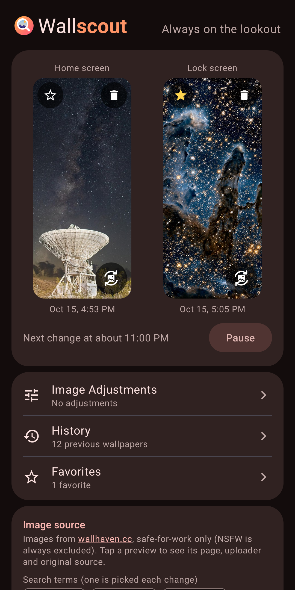
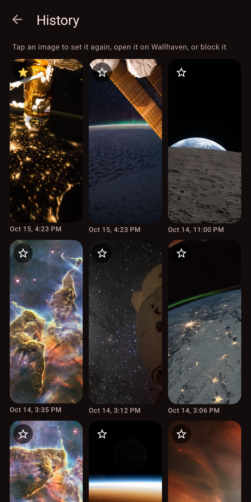
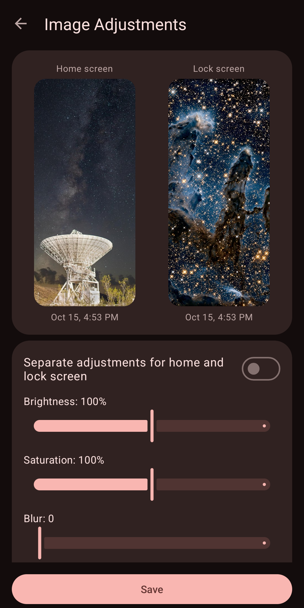
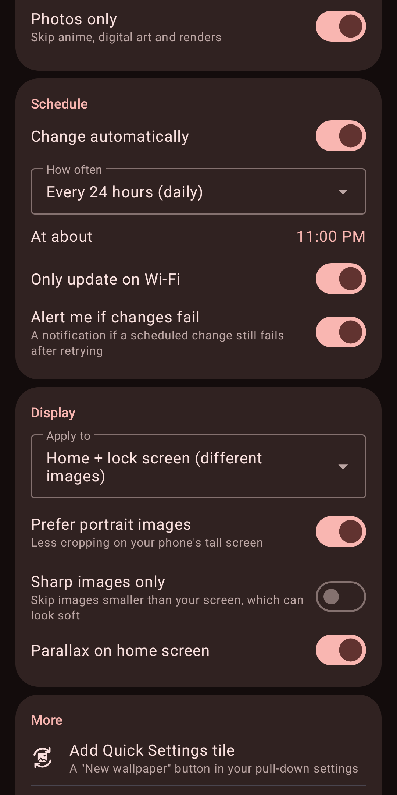

# Wallscout

**Always on the lookout.** An Android app that finds a new wallpaper for you on a schedule and sets it automatically.

Tell it what you're into, like space, mountains or the ocean, and Wallscout searches [Wallhaven](https://wallhaven.cc), picks a fresh high-resolution image and sets it as your home screen, lock screen, or both. No browsing, no account, no ads, no tracking.

<a href="https://play.google.com/store/apps/details?id=com.lewisfab.freshwall">Get it on Google Play</a>

<p>
  
  
  
  
</p>

## Features

- Your own search terms (one is picked each change) and excluded terms
- Changes every hour up to once a day, at about the time you choose, optionally only on Wi-Fi
- Different images for home and lock screens, or one for both
- "Photos only", portrait preference and "Sharp images only" (skips images smaller than your screen)
- Brightness, saturation and blur adjustments, optionally separate per screen
- Favorites, history, block an image, save the full-size original to Photos
- Quick Settings tile for a new wallpaper on demand
- Export and import of settings
- Safe-for-work only: NSFW images are always excluded
- Phone and tablet layouts

## Building

Requirements: JDK 17 or newer and the Android SDK (compile SDK 36). Point Gradle at the SDK with a `local.properties` file (`sdk.dir=...`) or the `ANDROID_HOME` environment variable.

```bash
./gradlew assembleDebug     # app/build/outputs/apk/debug/app-debug.apk
./gradlew bundleRelease     # app/build/outputs/bundle/release/app-release.aab
```

Signing keys are not part of this repository. Without them, debug builds use Android's standard debug key and release bundles are built unsigned. To sign releases, add `signing/upload.keystore` and a `signing/upload.properties` file with `storeFile`, `storePassword`, `keyAlias` and `keyPassword`.

Debug builds use their own application ID, so they install alongside the Google Play version.

## Privacy

Wallscout has no accounts, analytics or ads. Settings stay on the device, and the app only talks to Wallhaven to search for and download images. Full policy: <https://lewisfab.github.io/wallscout-privacy/>

## Credits

- Wallpapers come from [wallhaven.cc](https://wallhaven.cc) through its public API. Wallscout is an independent app and is not affiliated with Wallhaven.
- The images in the store screenshots and feature graphic are from NASA's Image and Video Library; see [store/image-credits.txt](store/image-credits.txt).

## License

[MIT](LICENSE)
